*
 Vikram Procter | October 16, 2026 
*

# NowWhat? - README

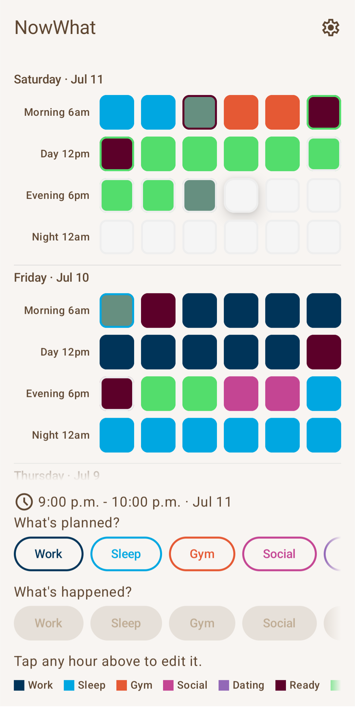

A personal Android app for tracking how you actually spend each hour of your day.

Every hour, on the hour, NowWhat asks two questions: **what did you just do, and what will you do next?** You answer by tapping one of your own preset activities (Work, Sleep, Gym, Social…), each with its own colour. Over time your answers become a colour-coded map of your days, and a statistics page that shows where your hours really go and how often your plans matched reality.

**Contents:** [What's new](#whats-new-in-this-release) · [Features](#features-at-a-glance) · [Installing](#installing) · [Getting started](#getting-started) · [A tour of the app](#a-tour-of-the-app) · [Under the hood](#under-the-hood) · [Status and roadmap](#status-and-roadmap)

---

## What's new in this release

**Version 2.1 fixes hourly notifications on fresh installs.** On recent versions of Android, a newly installed app isn't allowed to set exact alarms until you give it the **Alarms & reminders** permission. NowWhat's hourly reminders depend on exact alarms, so on a fresh install of 2.0 they silently never arrived. Now:

- **On first launch NowWhat asks for both permissions it needs,** one after the other: notifications (a normal system dialog), then Alarms & reminders. That one has no dialog, so the app explains why it needs it and opens the right settings page for you.
- **Notification settings show whether reminders can run.** A new **Alarms & Reminders** row reads "Allowed", or "Tap to allow" in red, and updates as soon as you come back from system settings.
- **Reminders resume straight away** once you grant access, without reopening the app.

If you installed 2.0, install 2.1 over it (no need to uninstall, and your data stays). NowWhat will ask for Alarms & reminders once on launch; allow it and the hourly notifications start again.

### New in 2.0

**The Statistics screen.** A new page in Settings turns your hour log into charts:

- Where your time went
- Plan versus reality
- Your sleep
- The shape of a typical day
- How your weeks have changed
- What you planned against what you did
- What you tend to do next

Two rows of filters at the top (time period and type of day) apply across the page.

This release also includes a polish pass over the whole screen:

- **Pinned filters.** The filter chips stay put while the charts scroll beneath them, with a soft fade instead of a hard edge.
- **A livelier donut.** It sweeps in when the page opens, with gaps and rounded corners between slices. Tap a slice, or its legend row, to raise it and fade the rest.
- **A tappable sleep chart.** Tap a night to read its average bedtime, waketime and hours slept.
- **A scrolling, tappable Portion of Time chart.** It shows about twelve weeks at a time, opens on the newest, and scrolls back through your whole history. Tap a line, or its legend entry, to highlight it and read its exact share for that week.
- **Tidier legends.** They wrap onto extra lines instead of scrolling, and every swatch on the page is the same rounded square.
- **Headline numbers that fit.** Values shrink to fit their card rather than being cut off, so "100/120" days tracked reads in full.

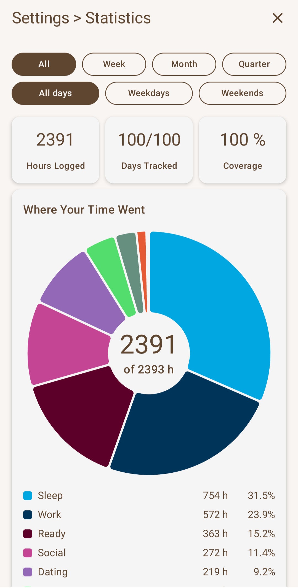

---

## Features at a glance

- **An hour-by-hour grid** of your days. Each hour is outlined in the colour of what you *planned* and filled with the colour of what you *actually* did, so you see plans and reality together.
- **Hourly notifications** with one-tap buttons, so you can log the hour that just passed without opening the app.
- **A default weekly schedule** that pre-fills each new day's plan.
- **A daily synopsis:** one short diary line per day, written in the app or straight from a notification.
- **A statistics page** with seven charts and two filters.
- **Your own activities,** with your own names and colours.
- **A day that starts when you want,** so late nights stay with the evening they belong to.
- **12- or 24-hour time,** and **light and dark themes** that follow your phone.
- **Backup and restore** to a single file you control. No account, no cloud, no tracking.

---

## Installing

NowWhat isn't on the Play Store; it installs as a standalone APK. To try it on an Android phone (Android 8.0 / API 26 or newer):

1. Download the latest `NowWhat.apk` from the [Releases](../../releases) page of this repository.
2. Copy it to the phone, or download it directly on the device.
3. Open the file. Android will ask permission to install from this source: allow "Install unknown apps" for whichever app you used to open it (your browser or file manager), then confirm the install.
4. Open NowWhat. On first launch it asks for two permissions: **notifications**, then **Alarms & reminders** (it opens that settings page for you; switch it on and press back). Both are needed for the hourly prompts. You can check or fix the second one later under **Settings → Notifications → Alarms & Reminders**.

**Updating:** install the new APK over the old one. There's no need to uninstall first, and uninstalling would delete your data unless you've exported a backup.

To build the APK yourself:

1. Open the project in Android Studio and let Gradle sync.
2. Run **Build → Build App Bundle(s) / APK(s) → Build APK(s)**, or from a terminal in the project root run `./gradlew assembleDebug`.
3. The APK lands at `app/build/outputs/apk/debug/app-debug.apk`. This debug build is signed with the local debug key and installs directly, which is all that's needed for sharing a demo. A Play Store submission would instead need a signed release build (see Android Studio's **Build → Generate Signed Bundle / APK** wizard).

## Getting started

1. **Set up your activities.** Go to **Settings → Edit Activities**. NowWhat starts with Work, Sleep, Gym, Social and Dating; rename, recolour, add or delete as you like.
2. **Choose when your day starts.** If you're often up past midnight, **Day Starts At** keeps those late hours with the evening they belong to.
3. **Optionally, set a weekly schedule** under **Edit Default Schedule**, so each day's plan fills itself in.
4. **Answer the hourly notifications,** or tap hours on the main screen and use the panel at the bottom.
5. **After a week or two, open Statistics.** On the sleep card, pick which activity means sleep.

---

## A tour of the app

### The main screen

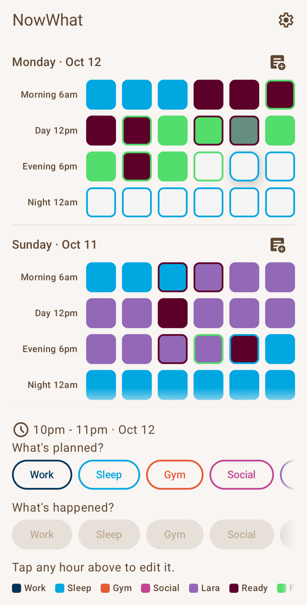

The main screen is a scrolling list of your days, newest first. Each day is split into four rows (Morning, Day, Evening and Night), with one box per hour.

Every box tells you two things at once. **Its outline is the activity you planned** and **its fill is the activity you actually did**. A box outlined in amber but filled with teal means "planned to go to the gym, ended up working." A box with only an outline is a plan you haven't logged yet, and an empty box is an hour with nothing in it.

### Logging an hour

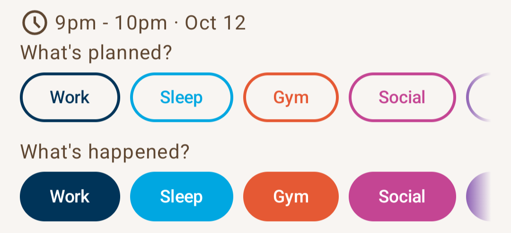

Tap any hour to select it, then use the panel at the bottom of the screen:

- **"What's planned?"** sets the plan for that hour.
- **"What's happened?"** logs what you actually did. These buttons are disabled for hours that haven't happened yet.

A colour legend underneath reminds you which colour is which activity, and an **Edit+** button jumps straight to your activities.

### Notifications

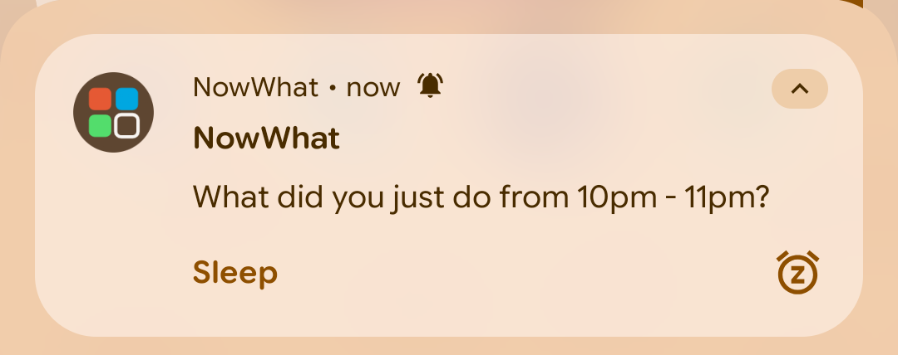

At the top of every hour, NowWhat asks what you did in the hour that just ended (for example, "What did you just do from 2pm - 3pm?"). The notification carries up to three activity buttons, so a single tap logs the hour without opening the app. The suggestions come from what you planned for that hour, then from what you did the hour before.

You can turn notifications off entirely, or set a **do-not-disturb window** (by default 10pm to 7am) during which they stay quiet.

The hourly prompts need Android's **Alarms & reminders** permission as well as the notification permission. NowWhat asks for it on launch, and the **Alarms & Reminders** row in notification settings shows whether it's allowed; if it says "Tap to allow", tap it to open the right settings page.

### Daily notes

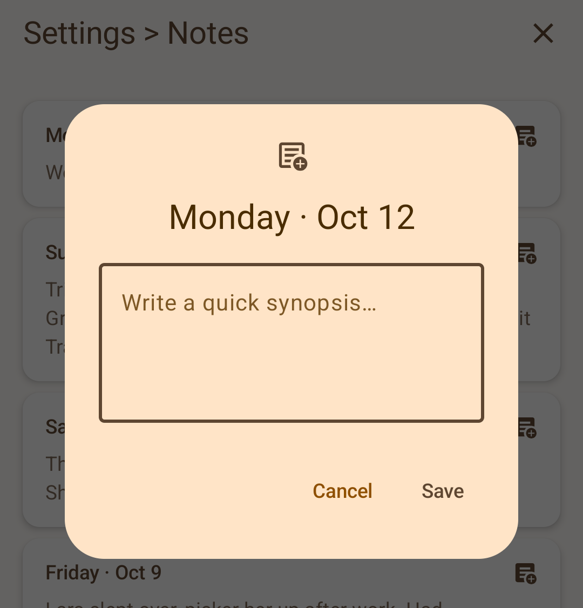  

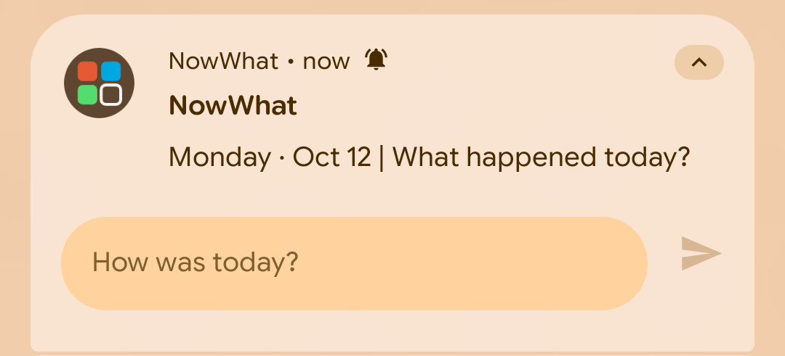

Each day can have a one-line **synopsis**, a short diary entry for the day as a whole. Tap the note icon in a day's header to write or edit it. The icon is filled when a day has a note and outlined when it doesn't.

Once a day, at a time you choose (9pm by default), a second notification asks for that day's synopsis. You can **type it straight into the notification** and it's saved, with no need to open the app. If you've already written one, you won't be asked.

All your notes are also listed together, newest first, under **Settings → Edit Notes**.

### Your weekly schedule

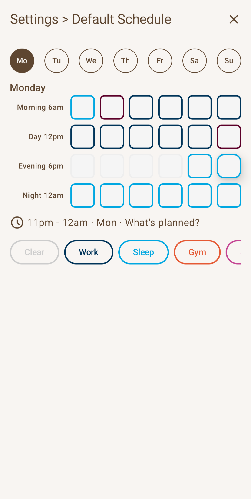

If your weeks follow a pattern, set it up once under **Settings → Edit Default Schedule**. Pick a weekday, then fill in its hours the same way you'd plan them on the main screen. Each new day starts with that weekday's plan already filled in.

The schedule only ever fills *empty* plans. It never overwrites a plan you've set by hand.

### Statistics

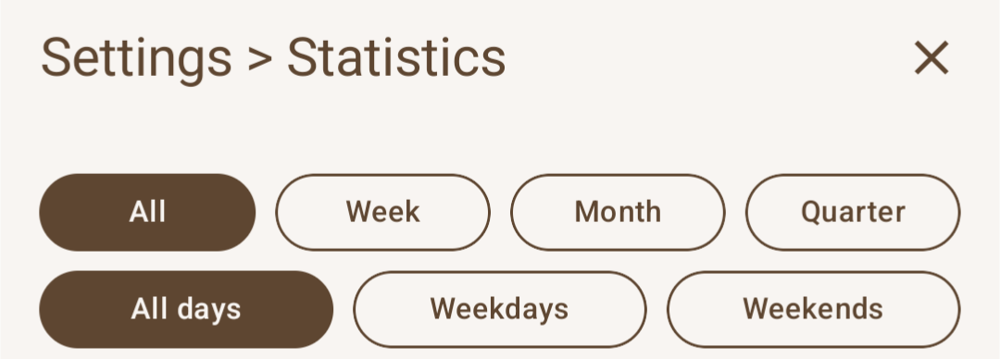

**Settings → See Statistics** opens a page of charts. Two rows of filter chips are pinned at the top:

- **Time period:** All, Week, Month or Quarter.
- **Type of day:** All days, Weekdays or Weekends.

The two combine, so "weekends over the last quarter" works. Below them, three headline cards show your **hours logged**, **days tracked**, and **coverage**, which is the share of hours in the range that have a log at all.

Each chart is described below. Most follow both filters; the few exceptions are noted, and the chart's caption always says what it covers.

#### Where Your Time Went

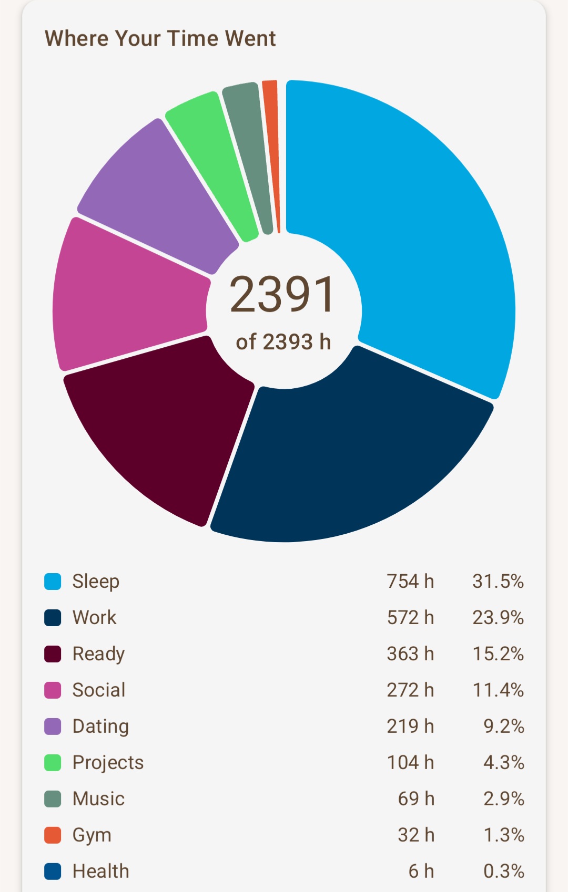

A donut showing your total hours and percentage for each activity. Unlogged hours, and hours logged to an activity you've since deleted, get slices of their own, so the ring accounts for every hour. Tap a slice or its legend row to highlight it, and tap again to clear.

#### Plan vs Actual

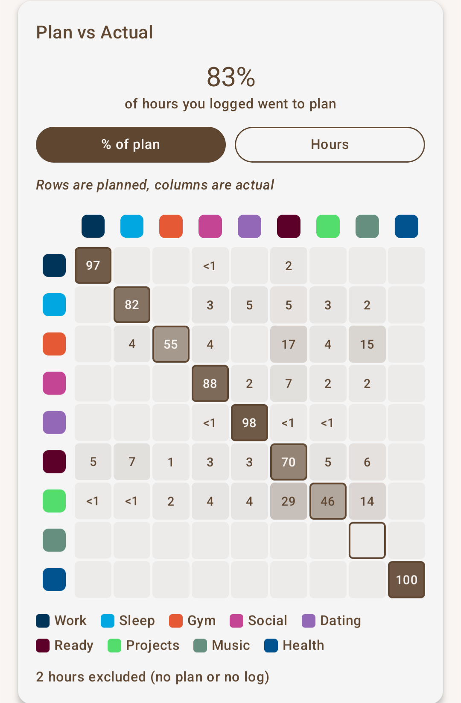

A grid with your plans as rows and what actually happened as columns, so the diagonal is "went to plan." It can show percentages of each plan or raw hours. The headline above it is your **adherence**: of the hours that had both a plan and a log, the share that matched.

#### Sleep

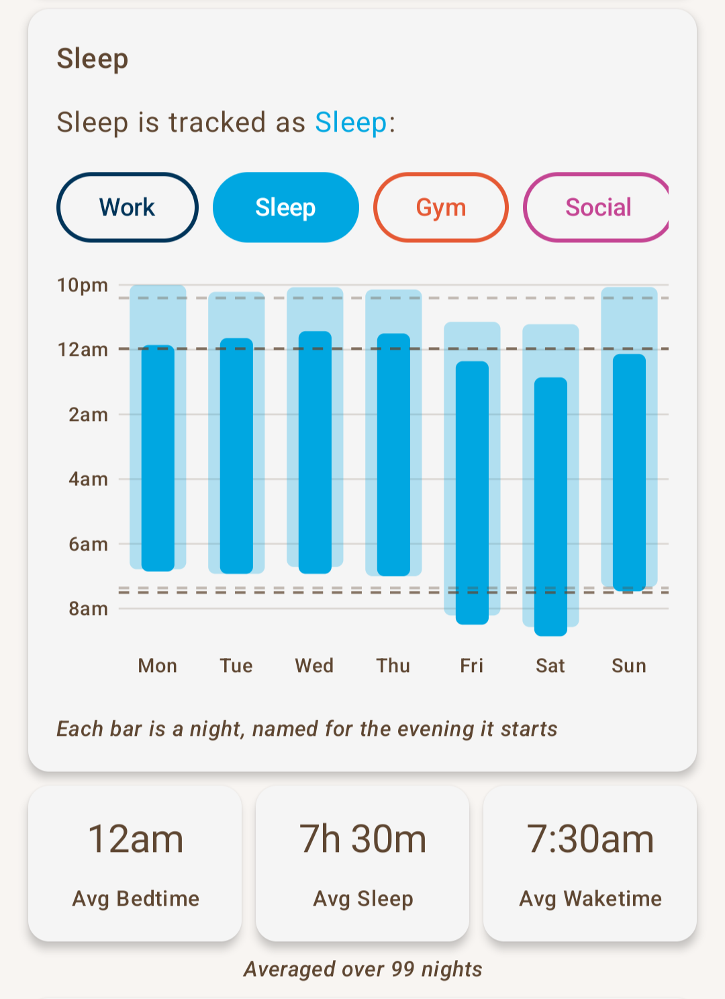

Choose which activity means sleep, and NowWhat finds your nights: runs of sleep hours, with short naps ignored. Each weekday gets a floating bar running from your average bedtime down to your average waketime. Faint wide bars behind them show what you *planned*, and dashed lines mark the averages. Tap a night to highlight it and read its averages: bedtime, waketime and hours slept. Three cards underneath give your overall average bedtime, sleep length and waketime.

This chart follows the time period but not the type of day, since its bars are already one per day of the week.

#### Day Rhythm

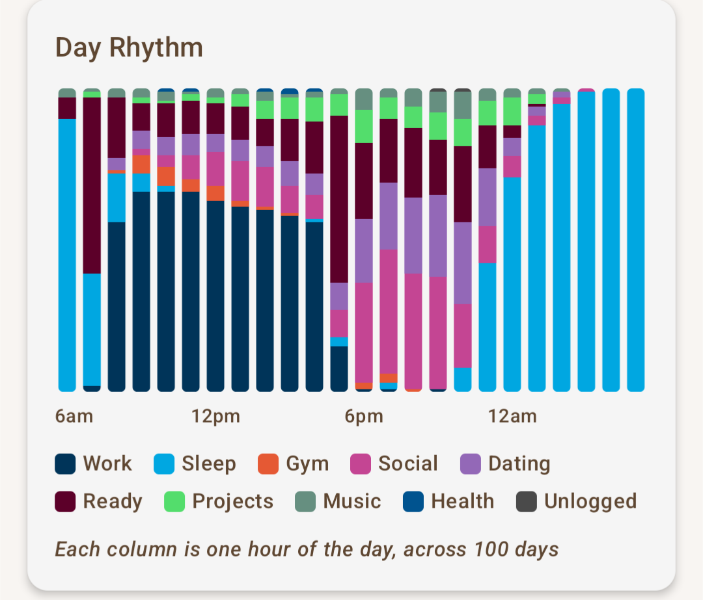

Twenty-four columns, one per hour of the day, each showing what that hour usually holds. The first column is the hour your day starts.

#### Portion of Time

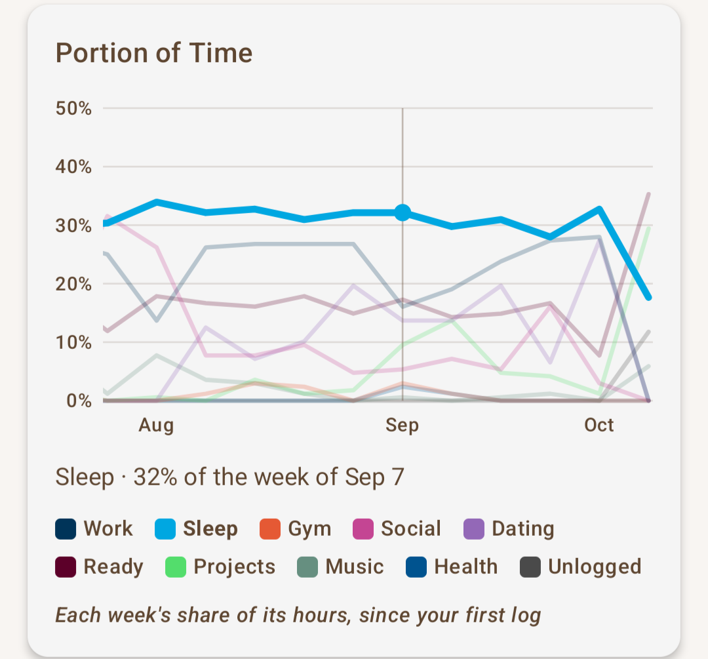

One line per activity, showing each week's share of its hours, all the way back to your first log. It shows about twelve weeks at a time and scrolls back through the rest. Tap a line (or its legend entry) to highlight it and read its exact share for that week, for example "Work · 23% of the week of Sep 14."

This chart follows the type of day but not the time period, because it's always your whole history.

#### Aspiration Gap

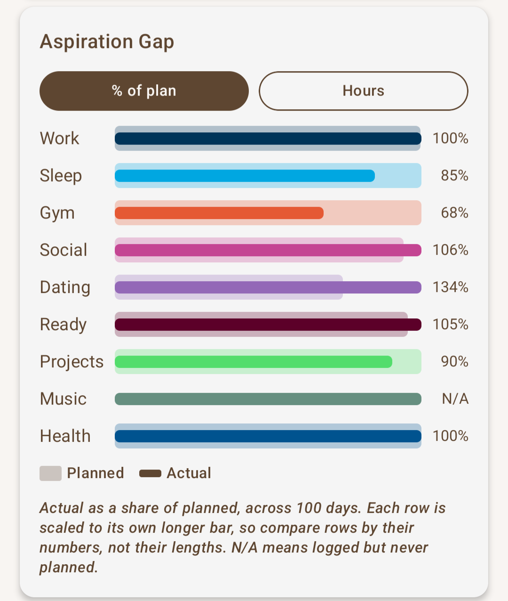

One row per activity, comparing the hours you planned for it (a wide, faint bar) with the hours you actually spent (a narrow, solid bar on top). A solid bar that stops short means less than planned; one that runs past means more. You can view it as raw hours or as a percentage of plan.

#### What Happens After

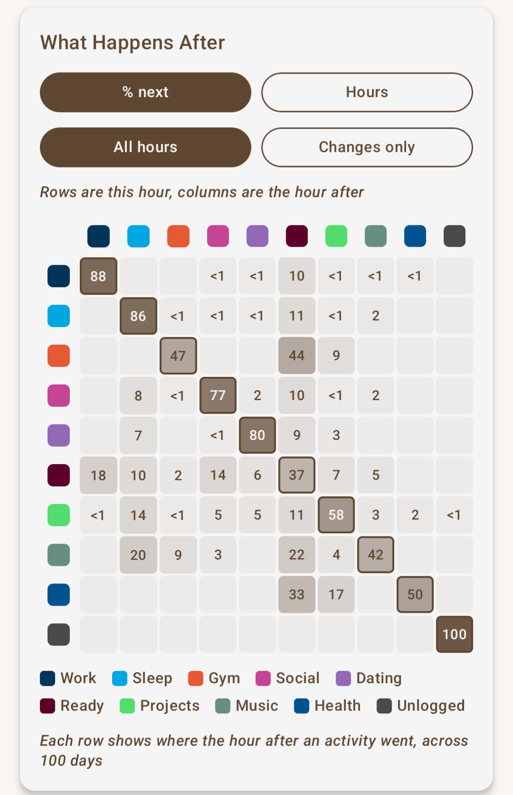

A grid in the same shape as Plan vs Actual, but with *this* hour's activity as the rows and the *next* hour's as the columns, so a row reads "after Gym, the next hour was Work 60% of the time." **Changes only** hides the stays (Sleep → Sleep and so on) and shows just the moments you switched activity.

### Settings

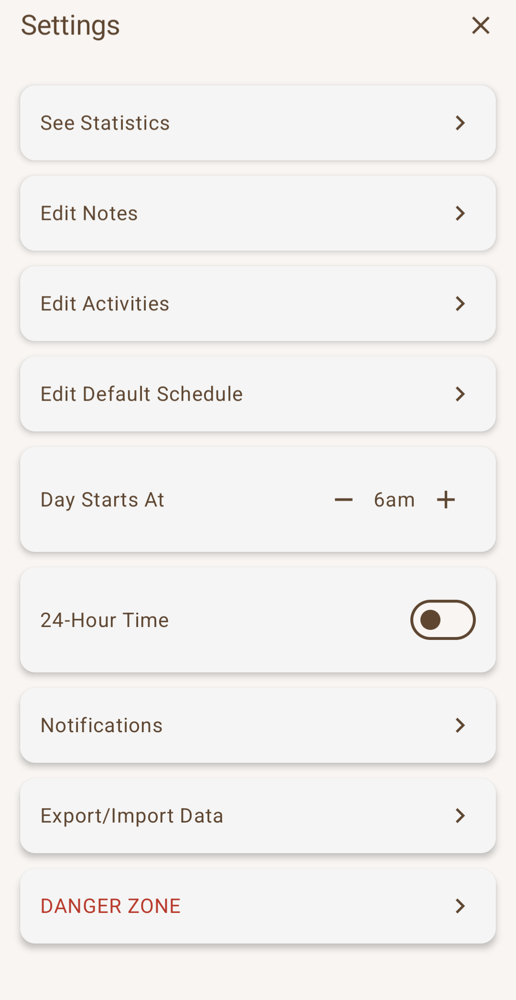
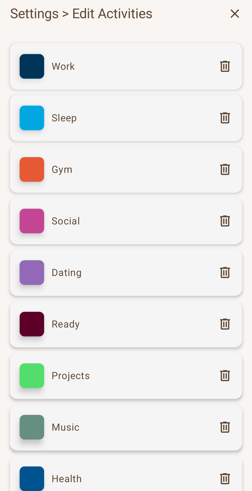

The settings page is a list of rows:

- **See Statistics:** the charts above.
- **Edit Notes:** browse and edit every daily synopsis.
- **Edit Activities:** add, rename, recolour or delete activities.
- **Edit Default Schedule:** your weekly plan.
- **Day Starts At:** the hour your day begins (6am by default).
- **24-Hour Time:** switches every time in the app between 12- and 24-hour format.
- **Notifications:** the master switch, whether Alarms & reminders is allowed, the do-not-disturb window, and the daily synopsis reminder.
- **Export/Import Data:** back up or restore everything.
- **Danger Zone:** clear logged hours, delete all notes, reset activities or clear the schedule. Each action asks you to confirm first.

### Backing up your data

Everything NowWhat knows lives on your phone. **Settings → Export/Import Data** saves it all to one file wherever you choose, and can restore from that file later. Importing *replaces* what's currently in the app rather than merging with it, and you're asked to confirm first.

---

# Under the hood

*The rest of this README is for anyone curious about how NowWhat is built, or picking the project up for development.*

## How it works

### The logical day

A NowWhat "day" doesn't run midnight-to-midnight: it runs from a configurable **start hour** (default 6am) to the same time the next calendar day. The small hours after midnight (e.g. 1am) therefore belong to the *previous* logical day's "Night" band. This keeps a single night's late hours grouped with the day they belong to rather than split across the calendar boundary. All timestamp ↔ day/hour conversions live in one place (`DayBoundry.kt`) and pivot on this start hour, so changing "Day Starts At" re-lays-out the entire grid consistently.

### Default schedule auto-fill

When a new logical day first appears, the app seeds that day's *planned* activities from the matching weekday's schedule template. Seeding is **fill-only**: it never overwrites a planned activity you set manually, and a "last seeded day" marker in DataStore ensures each day seeds only once. The seeding logic lives in one place (`Seeding.kt`) and is triggered from two spots: a one-shot seed when the ViewModel starts (covering app launch), and the hourly notification alarm (covering the day boundary while the app is open or in the background). Because the day boundary always falls on a whole hour, the hourly alarm lands exactly on it, so there is no need to poll. Changing "Day Starts At" also re-runs the seed, via a small collector on the setting.

### Daily synopsis notes

Each logical day can carry one short free-text synopsis. Saving empty text deletes the note rather than storing a blank row, so the filled/outlined icon always tells the truth. The hours view and the Notes settings screen share one editor dialog.

Notes are keyed by **logical day** (`LocalDate.toEpochDay()`), not by a timestamp. "Day Starts At" is configurable, so a timestamp-keyed note would drift onto the wrong day the moment that setting changed; an epoch-day number is stable wherever the day boundary sits. It also makes one-note-per-day structural, enforced by the primary key itself.

A day with a note but no logged hours still gets a row in the hours view: the days to display are the union of days with entries, days with notes, and today.

### Notifications

Hourly notifications fire on the hour using exact alarms. The engine is a **self-rescheduling one-shot alarm**: an exact alarm fires into `AlarmReceiver`, which immediately schedules the next hour's alarm before doing anything else (so the chain never breaks), then handles seeding and the notification. A `BootReceiver` reschedules on device restart, since Android clears alarms on reboot.

The inline action buttons log the *actual* activity for the hour that just passed via `NotificationActionReceiver`, which writes to Room directly and dismisses the notification. Suggestions come from the planned activity for that hour, then what you did the hour before, then a default, deduplicated and always at least one. The notification is deliberately **log-only**: with at most three buttons, planning the next hour from the shade isn't wanted.

**Permissions.** The engine needs two separate grants. `POST_NOTIFICATIONS` is a normal runtime permission with a system dialog. Exact alarms (`SCHEDULE_EXACT_ALARM`, "Alarms & reminders") are *special access*: on Android 14+ they start denied for a fresh install, and there's no dialog, only a settings page reached through `Settings.ACTION_REQUEST_SCHEDULE_EXACT_ALARM`. Without that access `scheduleNextAlarm` can't set anything, so `PermissionPrompts.kt` asks for both on launch (notifications first, then an explainer that opens the settings page), and the Notifications settings screen shows the alarm access as a status row that re-checks every time the screen resumes. When access is granted, Android sends `SCHEDULE_EXACT_ALARM_PERMISSION_STATE_CHANGED`; `BootReceiver` listens for it alongside `BOOT_COMPLETED` and restarts the chain immediately. The two checks live in `NotificationHelper` (`hasNotificationPermission`, `canScheduleExactAlarms`), so every caller asks the same question the same way.

When notifications are off, or the current hour falls inside the do-not-disturb window, the alarm still reschedules but skips posting, so silencing never breaks the chain. The day-change seed runs *before* those checks, so it keeps working even when notifications are silenced. The DND check reuses `withinHourSpan` from `DayBoundry.kt`, so windows that cross midnight work.

### The daily synopsis notification

The synopsis prompt rides the **same hourly alarm chain** rather than scheduling its own alarm: a once-a-day prompt is just an hour-equality check inside `AlarmReceiver`. Which day it asks about comes from `logicalDateOf`, so a reminder in the small hours asks about the day that is *ending*.

It carries an **inline text reply** (`RemoteInput` → `NoteReplyReceiver`). There's no way to pre-fill a reply field, so the prompt is skipped when the day already has a note, which means a reply can never silently overwrite one. Once saved, the receiver *replaces* the prompt with a short self-clearing "Synopsis saved for …" acknowledgement on the same notification ID. Cancelling it instead races Android's own reply handling, which restores the prompt with the typed text still in it.

It uses its own notification ID and its own quieter channel, so the two notifications never replace each other and can be silenced separately. The DND window doesn't apply to it (you chose that hour deliberately), but the master switch does.

### Statistics: the rules behind the numbers

All the arithmetic lives in `Statistics.kt`, a pure function of the log with no Android imports, which is what makes it testable on the JVM (see [Testing](#testing)). A few rules keep the numbers honest:

- **Denominators come from the calendar, not the log.** Every chart works from the same list of calendar hours in range, so an hour that was never logged still counts. Unlogged time shows up (grey in the donut, the rhythm columns and its own line) rather than letting a thinly logged week look like a confident picture. Today counts only its finished hours.
- **Hours follow the logical day.** A night belongs to the evening it starts, so "Weekends" on the sleep chart means Friday and Saturday nights.
- **Deleted activities count as unlogged** in the headline numbers, matching how they render in the grid (an empty box). The donut keeps them as their own slice so the ring still accounts for every hour.
- **Filters apply where they make sense.** The sleep bars ignore day type, since their x-axis already is the day of the week. Portion of time ignores the window, since it's a history, but follows day type. Captions name the days or nights each figure covers.
- **Sleep is derived, not stored.** A night is a run of consecutive sleep hours, found on the raw timestamp axis, bridging single-hour gaps and ignoring runs under three hours. Bedtimes are averaged against a noon pivot so midnight doesn't wrap the mean, durations are averaged directly, and waketime is derived as bedtime plus duration.
- **Portion of time is per-week and normalised.** Each week's shares are of that week's own calendar hours, so a partial first or current week is comparable with a full one.
- **Transitions walk the calendar.** "What Happens After" pairs each in-range hour with the next in-range hour by timestamp, so an hour with no row at all still counts as Unlogged, and under Weekends, Sunday night → Monday morning isn't counted.

The charts are drawn by hand rather than with a charting library: a donut, a floating bar chart, stacked columns and a line chart on Compose `Canvas`, plus the two matrices and the aspiration gap's paired bars as ordinary Compose layouts, since every cell or row in them holds text. Each chart is generic: it takes plain slices, series and labels, and the screen decides what they mean. A few drawing techniques worth knowing about:

- **Rounded slices.** Donut slices are rounded by drawing each slice's shrunk outline, then filling it *and* stroking it with a round-joined line. Their gaps are parallel offsets, so each gap is the same width from rim to hole.
- **Fading as a layer.** A faded slice is drawn into its own layer and faded as a whole. Each slice is two draw calls, so fading each call separately would double-paint the overlap.
- **The scrolling line chart** is two canvases: a fixed gutter for the axis labels and a wider plot inside `horizontalScroll`. Both share one y-mapping, so labels stay level with their lines.

### Theming and dark mode

The app follows the system light/dark setting. Rather than routing every screen through `MaterialTheme.colorScheme`, the handful of UI "chrome" colours (background, text, card fill, borders, cancel grey, danger red) are exposed from `Color.kt` as composable accessors: each name resolves to a light or dark value based on `isSystemInDarkTheme()`, backed by an explicit light/dark value pair.

One caveat: a composable accessor can only be read from a composable context. Any use inside a non-composable draw scope (the gradient fades, the charts) first reads the colour into a local `val`. The activity palette is deliberately *not* themed: those colours are stored per activity in the database as ARGB ints, so they're data, and they look identical in both themes.

### Data backup (export / import)

Both directions go through Android's **Storage Access Framework**: the system file picker hands the app a `Uri` for exactly the one file chosen, so no broad storage permission is needed. Serialization is hand-rolled with the built-in `org.json` (no dependency): four arrays (activities, entries, schedule, notes) plus a `BACKUP_VERSION` field, currently **2**. Version 1 files, written before notes existed, still import cleanly, because the notes array is read with `optJSONArray` and defaults to empty.

**Import is replace, not merge:** the whole database is wiped and rebuilt inside a single Room **transaction**, so a mid-restore failure rolls back. Activity **IDs are preserved** across the round-trip, because hour entries and schedule slots reference activities by ID; letting Room generate fresh IDs would silently repoint every logged hour at the wrong activity. The file is parsed *before* the transaction opens, so a malformed file fails loudly and touches nothing.

## Tech stack

- **Kotlin** + **Jetpack Compose** (declarative UI)
- **Room** (SQLite) for record data (activities, hour entries, schedule, notes), processed via **KSP**; schema export enabled, with a real `@AutoMigration` in place
- **Jetpack DataStore** (Preferences) for scalar settings
- **ViewModel** + **Kotlin Flow** + **StateFlow** for reactive state
- **AlarmManager** (exact alarms, with the special-access permission requested in-app) + **BroadcastReceiver**s for the self-rescheduling on-the-hour notification engine, including `RemoteInput` inline reply
- **Storage Access Framework** + `ContentResolver` for user-driven file export/import; **`org.json`** for backup serialization
- **Material Design 3** with a custom, system-following light/dark colour theme and vector drawable icons
- **Compose `Canvas`** and Compose animation for hand-drawn, animated and tappable statistics charts (no charting library)
- **JUnit 4** local unit tests on the JVM for the statistics arithmetic
- Built in Android Studio; tested on a physical device over wireless ADB

## Architecture

Data flows in one direction: **Entity → DAO → Database → ViewModel → Composable**, with DataStore as a parallel source for settings. Reads are exposed as reactive `Flow`s and `StateFlow`s, so the UI updates itself whenever the data changes. Events flow upward via callback lambdas (state hoisting).

The **notification engine is a second entry point into the data layer**, living outside the ViewModel and Compose lifecycle. `AlarmReceiver`, `NotificationActionReceiver`, `NoteReplyReceiver` and `BootReceiver` (which reschedules on reboot and when alarm access is granted) reach Room and DataStore directly through `AppDatabase.getDatabase(context)` and `SettingsStore(context)`. `NotificationHelper` (a stateless `object`) owns channel creation, notification building and alarm scheduling.

Where a rule must hold in both worlds, it's extracted into a plain top-level `suspend fun` that takes its DAO as a parameter, so the ViewModel and the receivers share one implementation:
- `Seeding.kt` for day seeding.
- `Notes.kt` for saving a synopsis (trim, and delete rather than store blank).

**Statistics are a pure function of the data.** The ViewModel `combine`s entries, activities, the day-start hour, the filter and the chosen sleep activity, runs `computeStatistics` off the main thread (`flowOn(Dispatchers.Default)`), and exposes the result as a `StateFlow<Statistics?>`. The screen maps it into generic chart types (`ChartSlice`, `ChartSeries`, `PairedBar`) at the UI boundary, which is also where colours are attached; `Statistics.kt` itself never touches Compose. Presentation-only choices, such as the matrix toggles and which slice or line is selected, stay out of the `combine`, so changing them never triggers a recompute.

**Navigation** uses a simple state-based approach: an `AppScreenState` enum held in `MainActivity`, with a `when` expression swapping between screens. A single `BackHandler` uses an `AppScreenState.parent()` mapping to step up the tree, and on the main screen it disables itself so the back press falls through and the app closes normally.

<b>UI component tree</b>

- `MainActivity`: holds screen state and ViewModel, wraps everything in `NowWhatTheme`, and owns the back-navigation `BackHandler`
  - `LaunchPermissionPrompts`: the first-launch notifications dialog and Alarms & reminders explainer (draws nothing otherwise)
  - `NowWhatScreen`: owns the Scaffold with TopBar (topBar slot) and EntryPanel (bottomBar slot)
    - `TopBar`: title + settings icon
    - `HoursView`: scrollable `LazyColumn` of days with top/bottom fade effects
      - `DaySection`: header row (date label + optional `noteButton` slot) above four part-of-day rows
        - `PartOfDayRow`: band label + a row of boxes
          - `HourBox`: one hour. Outline = planned colour, fill = actual colour; rounded corners, shadow when selected; tappable
    - `EntryPanel`: pinned bottom panel with right-edge fade effect
      - `PresetButton`: outlined (planned) or filled (actual) button per activity; supports an `enabled` flag
      - `ActivityLegend`: colour → activity key (a single scrolling line here, so the panel's height stays fixed)
  - `NowWhatSettingsScreen`: settings list of `SettingRow`s
    - `SettingRow`: rounded card row with optional `leading` and `content` slots and a trailing slot (chevron / switch / stepper)
    - `NumberStepper`: reusable −/value/+ stepper with a `format` lambda
    - `ActivitiesSettingsScreen`: each activity as a `SettingRow` with a colour swatch, an inline-rename field and a delete action; keyboard-aware via `imePadding`
    - `DefaultScheduleSettingsScreen` → `WeekdayPicker` + `DaySection` + preset row
    - `NotesSettingsScreen`: `LazyColumn` of `NoteCard`s, tap to open `NoteDialog`
    - `StatisticsSettingsScreen`: pinned filter chips (with a fade beneath) above a `LazyColumn` of chart cards
      - `StatsChipRow`: generic chip row for the filters and the card toggles
      - `StatsCard`: the card shell every chart sits in; `HeadlineStat`: a card with one big number that shrinks to fit
      - `DonutChart` + `DonutLegend`: the activity donut, animated, with selectable slices and rows
      - `ActivityMatrixGrid`: both matrices
      - `SleepBarChart`: floating sleep bars with planned ghost bars and dashed averages; selectable nights
      - `StackedColumnChart`: the day rhythm
      - `LineChart`: portion of time, scrolling, with selectable lines and a week marker
      - `PairedBarChart` + `PairedBarKey`: the aspiration gap and its planned/actual key
      - `SwatchLegend`: colour → name key for anything, activity or not; wraps by default and can be made selectable (`ActivityLegend` is built on it). `LegendSwatch` is the one shared swatch.
    - `NotificationsSettingsScreen`: the master switch, the Alarms & Reminders status row, DND and synopsis settings
    - `DataSettingsScreen`, `DangerZoneSettingsScreen`
    - `ConfirmDialog`: reusable destructive-confirmation dialog, shared by Danger Zone and import
    - `NoteDialog`: reusable synopsis editor, shared by the hours view and the notes screen
    - `NoteCard`: notes-list card, with the date above a three-line preview
    - `TopBarSettings`: "Settings" title (+ optional breadcrumb path) + back icon

## Data model

Four Room tables:

- **Activity** (`activities`): a preset with a name, a colour (ARGB Int), and an auto-generated ID.
- **HourEntry** (`hour_entries`): one hour, holding a timestamp (epoch millis, truncated to the hour), a *planned* Activity ID, and an *actual* Activity ID (both nullable).
- **ScheduleEntry** (`schedule_entries`): one slot of the weekly template: `dayOfWeek` (1–7, ISO Mon–Sun), `hourOfDay` (0–23) and a *planned* Activity ID. A composite **unique index** on `(dayOfWeek, hourOfDay)` guarantees one row per slot.
- **Note** (`notes`): one daily synopsis, with `epochDay` (the logical day) as the **primary key** and `text`.

The database is at **version 4**. Schema export is enabled and both baselines (`3.json` and `4.json`) are committed. The `notes` table arrived through `@AutoMigration(from = 3, to = 4)`, verified on a device by installing over an existing v3 build with data intact. The destructive fallback is narrowed to versions 1 and 2 (`fallbackToDestructiveMigrationFrom(true, 1, 2)`), so a forgotten migration on any later version fails loudly instead of silently wiping the database.

Scalar settings live in DataStore, not Room:

| Key | Type | Default | What it holds |
|---|---|---|---|
| `is_24_hour` | Boolean | false | 12- or 24-hour time |
| `day_start_hour` | Int | 6 | The hour the logical day begins |
| `lastSeededDay` | Long | −1 | Epoch day of the last schedule seed |
| `notifications_enabled` | Boolean | true | The master notification switch |
| `dnd_start_hour` / `dnd_end_hour` | Int | 22 / 7 | The do-not-disturb window |
| `note_notifications_enabled` | Boolean | true | The daily synopsis reminder |
| `note_notification_hour` | Int | 21 | When the reminder fires |
| `sleep_activity_id` | Long | unset | Which activity means sleep on the statistics page |

Supporting UI classes, not persisted:
- **`HourSlot`** and **`Day`** carry the grid's data.
- **`Statistics`** is the computed result for the current filters.
- **`ChartSlice`**, **`ChartSeries`** and **`PairedBar`** are the plain label + colour + value types the charts draw from.

## Testing

The statistics arithmetic has local unit tests that run on the computer's JVM rather than on a phone, so they finish in seconds:
- `SleepStatisticsTest`: sleep episodes and averages, with the day-rhythm tests alongside.
- `WeeklySharesTest`: the weekly buckets behind portion of time.
- `ShareSeriesTest`: turning those buckets into chart lines.
- `ShareAxisTest`: fitting the line chart's scale.

They live in `app/src/test/java/com/example/nowwhat/`. Run them from the green ▶ beside a test in Android Studio, or with `./gradlew :app:testDebugUnitTest`. Running a test under **Debug** is also the quickest way to step through the statistics code, since nothing has to be installed.

---

## Status and roadmap

**Every planned feature is built,** including the statistics screen and its polish pass. The app runs day to day on a physical phone.

### Roadmap

- [ ] **Database integrity:** null out an activity's references (logged hours, planned hours, schedule slots) when it's deleted, instead of leaving them pointing at a dead ID; and a unique index on `hour_entries.timestamp`, with a migration that removes any duplicate hours first
- [ ] More colours for activities, or a toggle that shows each activity's first letter on the main page, so activities sharing a colour can be told apart
- [ ] **Bug:** settings rows with controls (e.g. Day Starts At, 24-Hour Time) sit taller than the plain rows
- [ ] Show the year in day labels when it isn't the current one, so the Notes list doesn't read ambiguously once history spans more than a year (e.g. two "Friday · Sep 11" entries)
- [ ] Search over notes on the Notes settings screen
- [ ] Merge-style import (currently replace-only); would need activity-ID-collision handling

Placeholder assumptions: the four time bands are fixed 6-hour blocks anchored at the start hour (Morning = start, then +6/+12/+18), and the starter presets are Work, Sleep, Gym, Social, and Dating.

<b>Completed work, in build order</b>

- [x] Redesign the data model to the preset-based schema (an `Activity` table; planned + actual activity per hour)
- [x] Build the new UI scaffolding bottom-up with stand-in data and `@Preview`
- [x] Wire the scaffolded UI to the ViewModel and Room
- [x] Settings screen: manage preset activities (add, edit, delete) and their colours
- [x] Visual polish: rounded corners, Material icons, spacing, theming, gradient fades
- [x] Auto-populate today's date in the HoursView on launch
- [x] Prevent logging "actual" activities for hours in the future
- [x] Configurable start-of-day hour (drives the logical-day system)
- [x] 24-hour / 12-hour time format toggle
- [x] Default schedule: per-weekday recurring planned activities that auto-populate new days
- [x] Hourly notification engine: exact alarms + reschedule-on-fire + boot receiver + `POST_NOTIFICATIONS` permission + notification channel + inline action buttons (log actual from the shade)
- [x] Notifications settings: master switch + do-not-disturb window
- [x] Danger zone in settings: clear logged hours / reset activities / clear default schedule, each behind a confirmation dialog
- [x] Data export/import: single-file **JSON** backup via the system file picker (replace-on-import, IDs preserved, transactional). *Implemented as JSON via the Storage Access Framework rather than CSV via the share sheet, for lossless escaping and one-file simplicity.*
- [x] Show the hour being logged in the notification. *(Planning the next hour from the notification is explicitly not wanted; notification format options were deferred as low priority.)*
- [x] Retire the one-minute seeding ticker in favour of the hourly alarm as the day-change pulse
- [x] System-following dark mode colours *(fonts left at Material defaults on purpose)*
- [x] Unify the activity settings screen onto `SettingRow`
- [x] Android back button to navigate instead of close the app
- [x] Cleanup: unused imports removed; legacy `ActivitiesSettings.kt` deleted after inlining
- [x] Enable Room schema export and commit the v3 baseline (migration-readiness)
- [x] Write a real `@AutoMigration` (v3 → v4 for the `notes` table) and narrow the destructive fallback to versions 1–2
- [x] Unify hour/time formatting onto `formatHourLabel`; share one `DateFormatter` for day labels
- [x] Daily Synopsis: a `notes` table holding one short diary-style entry per logical day, with the schema migration, backup support, and the editing UI (day-header button + Notes settings screen)
- [x] Daily Synopsis **notification**: a prompt to write the day's synopsis, with its own enable/disable toggle, a configurable time-of-day, and inline reply from the shade
- [x] **Statistics page** in settings, showing how time is spent:
  - [x] **Filter chips:** two rows, by time period (all, week, month, quarter) and by day type (all days, weekdays, weekends)
  - [x] **Headline stat cards:** hours logged, days tracked, coverage
  - [x] **Donut chart:** total hours (and percentage) per activity
  - [x] **Plan vs actual matrix,** with the plan adherence percentage
  - [x] **Sleep:** headline cards (average bedtime, sleep length, waketime) and a floating bar per night of the week, with planned ghost bars and dashed averages
  - [x] **Day rhythm:** 24 stacked columns, one per hour of the day
  - [x] **Portion of time line chart:** each week's share of its hours per activity, since the first log
  - [x] **Aspiration gap:** planned vs logged hours per activity, as hours or as a percentage of plan
  - [x] **Transition matrix ("What Happens After"):** this hour's activity against the next hour's, with Unlogged as its own state and a changes-only view
- [x] **Statistics polish pass:**
  - Pinned filter chips with a fade beneath.
  - "Activity Shares" renamed "Where Your Time Went".
  - The donut: an entry animation, slice gaps, rounded corners, and selectable slices and legend rows.
  - The portion-of-time chart: scrolls about twelve weeks at a time, with selectable lines, a week marker and a readout.
  - The sleep chart: selectable nights, with a readout of that night's averages.
  - Wrapping legends with one shared rounded-square swatch, matrix headers included.
  - Headline values that shrink to fit.
  - A clearer plan-vs-actual empty state.
  - One shared ghost-bar transparency.
  - Ring thickness as a fraction of the donut's size.
- [x] **Unit tests:** JVM tests for sleep, the day rhythm, the weekly shares, the chart-line mapping and the axis fitting
- [x] **V2.1 notification fix:** request Alarms & reminders access on launch (with an explainer), restart the alarm chain when it's granted, and show its status in notification settings, so hourly prompts work on a fresh install

